<p align="center">
  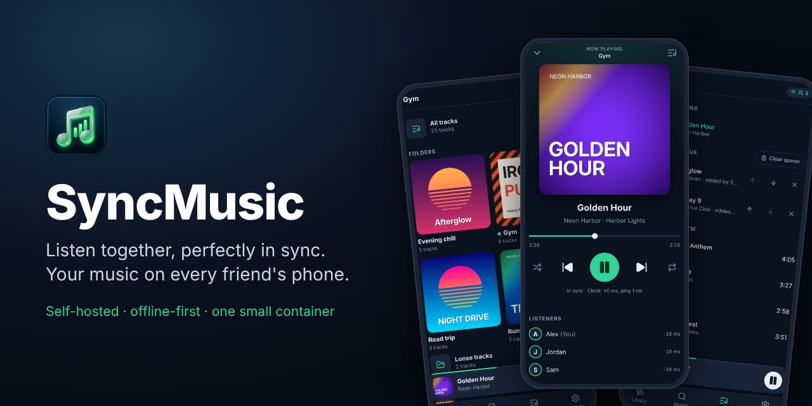
</p>

<p align="center">
  <a href="https://github.com/RafalPolawski/SyncMusic/actions/workflows/publish.yml"></a>
  <a href="https://github.com/RafalPolawski/SyncMusic/releases/latest"></a>
  <a href="https://github.com/RafalPolawski/SyncMusic/pkgs/container/syncmusic"></a>
  <a href="LICENSE"></a>
</p>

<p align="center">
  <a href="#quick-start">Quick start</a> ·
  <a href="#features">Features</a> ·
  <a href="#screenshots">Screenshots</a> ·
  <a href="#how-it-works">How it works</a> ·
  <a href="#configuration">Configuration</a> ·
  <a href="docs/README.pl.md">🇵🇱 Po polsku</a>
</p>

## Why

Sharing one speaker at the gym annoys everyone else, and sharing one pair of earbuds is gross. Streaming apps can't play *your* files and fall apart when the signal in the basement drops. SyncMusic is a small server you run at home (or on a Raspberry Pi) that plays your own music folder on everybody's phone in sync, keeps going without a connection and needs nothing installed besides a browser.

## Features

- 🎧 **Tight sync.** NTP-style clock sync and gentle playback-rate correction keep every phone on the same beat. In the end-to-end tests two emulated Android phones end up about **1 ms** apart.
- 📶 **Made for bad connections.** The next tracks are downloaded ahead, folders can be saved for offline use, Opus transcoding makes files 5–10× smaller, and the app reconnects on its own.
- ✈️ **Keeps playing offline.** Each phone follows the room's timeline by itself, moves to the next track at the right moment without a network and catches up when the connection returns.
- 📁 **Your folders are your playlists.** Subfolders of the music directory become playlists, `.m3u` files are imported and loose files get their own list. Tags and cover art are read automatically.
- 👥 **Made for groups.** A shared queue ("added by Ola"), shuffle and repeat for the whole room, the list of listeners with how far off each phone is, and "wait for everyone" so a new track starts when all phones have loaded it.
- 🔒 **Personal pause.** Taking out your earbuds or answering a call pauses only your phone. *Back to the room* drops you back in, in sync.
- 📦 **One small container.** Go server, SQLite and the web app in a ~47 MB image for `amd64` and `arm64`, plus single binaries for Linux, macOS and Windows. No database server, no accounts, one shared password.
- 📱 **Installable app** in English and Polish, with lock-screen controls and Bluetooth delay compensation.

## Quick start

You need Docker, a folder of music and an HTTPS address for the phones (browsers only allow installing the app and offline storage over HTTPS). [Tailscale](https://tailscale.com) gives you that for free, works across networks and needs no port forwarding.

**1. Start the server**

```sh
mkdir syncmusic && cd syncmusic
curl -fsSLO https://raw.githubusercontent.com/RafalPolawski/SyncMusic/main/compose.yaml
cat > .env <<'EOF'
MUSIC_DIR=/path/to/your/music
SYNCMUSIC_PASSWORD=pick-a-password
SYNCMUSIC_TRUST_PROXY=true
EOF
docker compose up -d
```

**2. Give it an HTTPS address**

```sh
tailscale serve --bg 8080      # → https://<machine>.<tailnet>.ts.net
```

Invite your friends to your tailnet or [share the machine](https://tailscale.com/kb/1084/sharing) with them, and have them install the Tailscale app. Prefer a sidecar container, your own domain or no Docker at all? See [Deployment](docs/deployment.md).

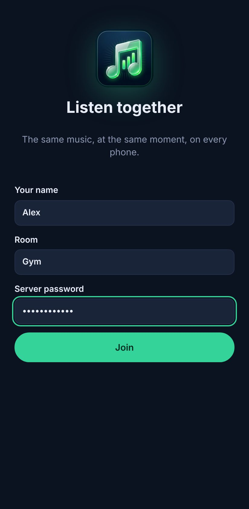

**3. Join from every phone**

Open the address, enter your name, a room (for example *Gym*) and the password, then choose **Add to Home screen** (Chrome menu ⋮ on Android) to install the app. Everyone who enters the same room hears the same music.

Pick a folder, tap **Play**, and you are listening together.

To pin a version instead of following `latest`, add `SYNCMUSIC_VERSION=1.0.0` to `.env`. To update: `docker compose pull && docker compose up -d`. Phones offer the new version with a banner and never interrupt a playing song.

<br clear="right">

### Music folder layout

```
music/
├── Gym/                    → playlist "Gym"
│   ├── 01 - Warm up.mp3
│   └── Leg day/            → nested folder, also part of "Gym"
├── Evening chill/          → playlist "Evening chill"
├── running.m3u             → playlist from an .m3u file
└── Some song.flac          → "Loose tracks"
```

Titles, artists and albums come from tags, or from file names like `03 - Artist - Title.mp3`. Embedded cover art and `cover.jpg` / `folder.jpg` are used. MP3, FLAC, Ogg Vorbis/Opus, M4A (AAC/ALAC), WAV, AIFF, WMA, APE, WavPack and MKA are supported. New files are picked up every 15 minutes, or right away with *Settings → Rescan library*.

## Screenshots

<table>
  <tr>
    <td align="center">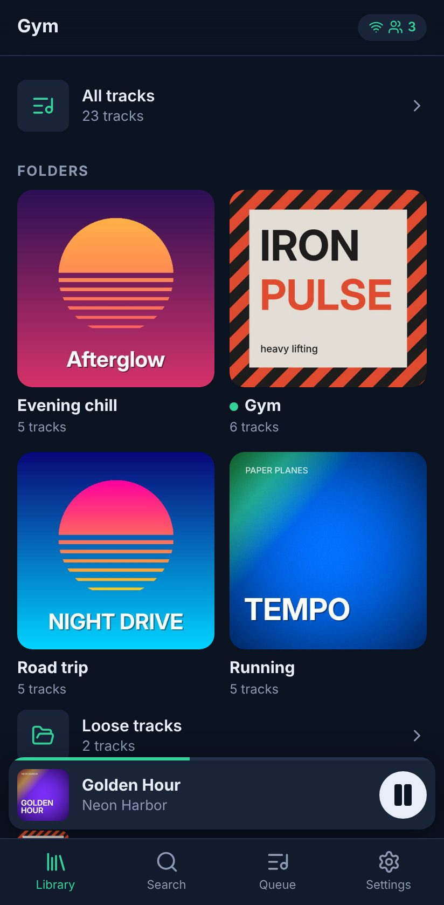<br><sub><b>Library</b><br>folders, playlists, loose tracks</sub></td>
    <td align="center">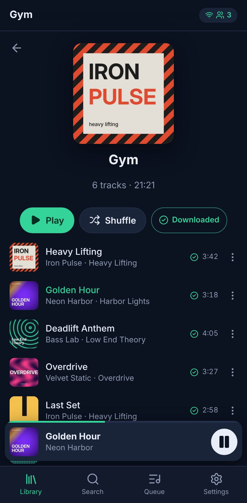<br><sub><b>Folder</b><br>play, shuffle, keep offline</sub></td>
    <td align="center">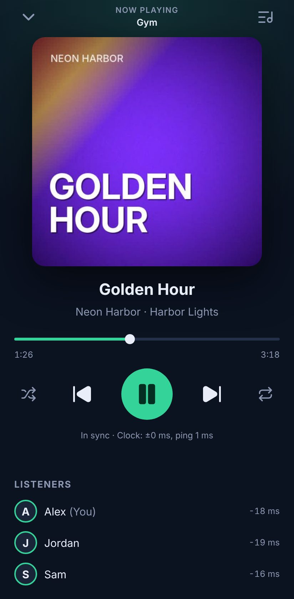<br><sub><b>Now playing</b><br>sync status and listeners</sub></td>
    <td align="center">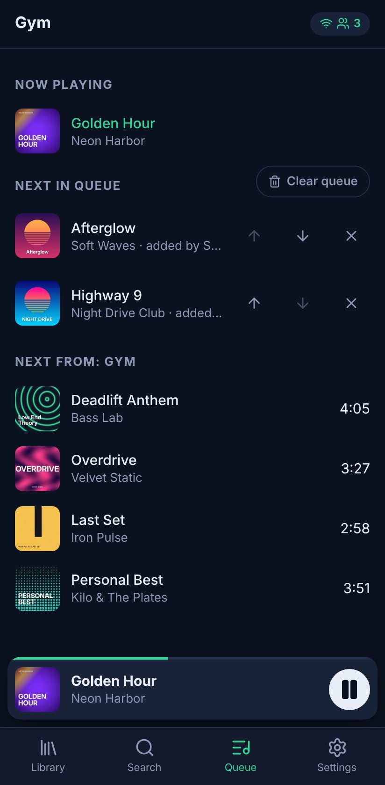<br><sub><b>Shared queue</b><br>everyone can add and reorder</sub></td>
  </tr>
  <tr>
    <td align="center">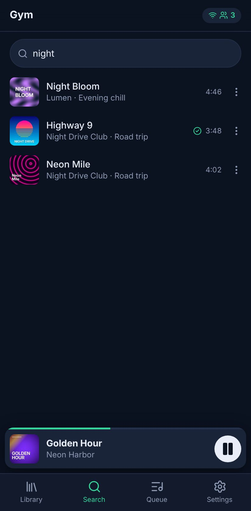<br><sub><b>Search</b><br>ignores case and accents</sub></td>
    <td align="center">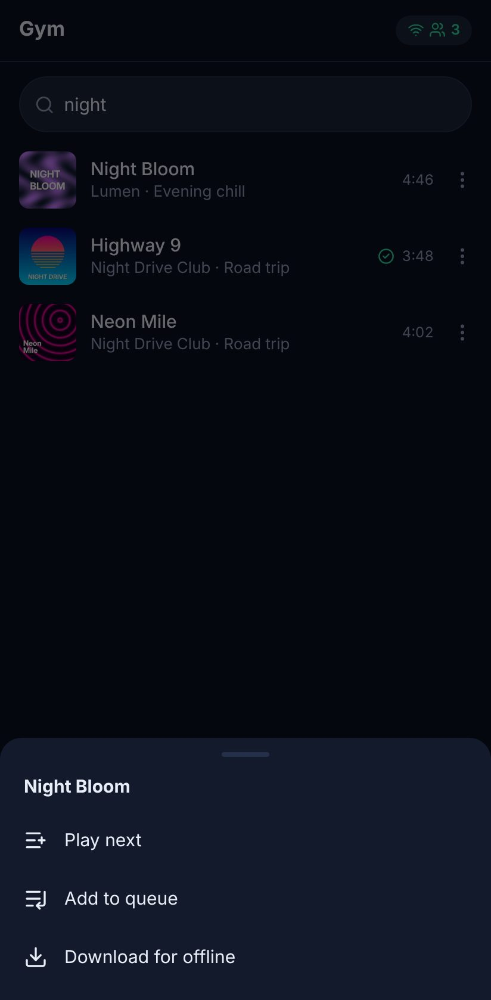<br><sub><b>Track menu</b><br>play next, queue, download</sub></td>
    <td align="center">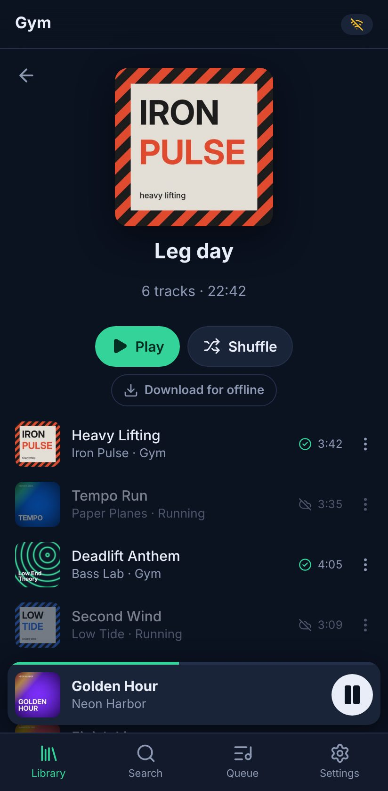<br><sub><b>Offline</b><br>saved tracks keep playing</sub></td>
    <td align="center">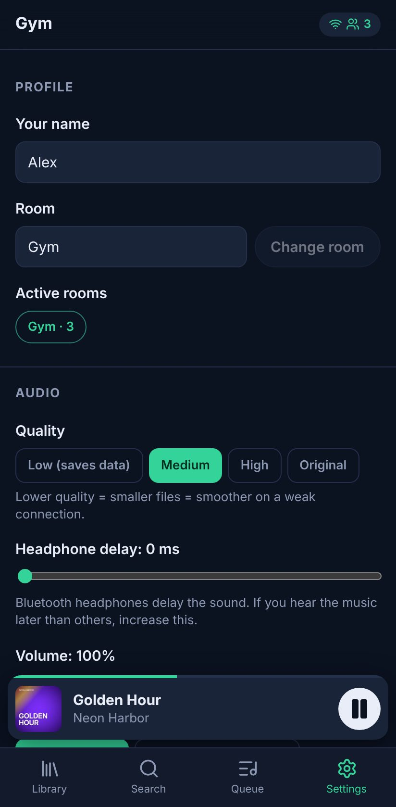<br><sub><b>Settings</b><br>quality, headphone delay</sub></td>
  </tr>
</table>

The screenshots come from the real app with a generated demo library: `make screenshots` recreates them.

## Using it at the gym

- **Play / Shuffle** on a folder starts it for the whole room. The **⋯** menu on a track plays it next or adds it to the shared queue.
- **Pause in the app** pauses everyone. **Headphone buttons, the lock screen and phone calls** pause only your phone, so taking out an earbud between sets doesn't stop the others. You can switch this to "control the whole room" in the settings.
- **Download for offline** on a folder keeps it on the phone. The next few tracks are always fetched ahead anyway.
- **Weak signal?** Set *Quality → Low* (Opus 64 kb/s, about 0.5 MB per minute) and save the playlists at home.
- **Bluetooth headphones** add delay. If you hear the music later than your friends, raise *Settings → Headphone delay*. The listener list on the player screen shows how far off each phone is.

## How it works

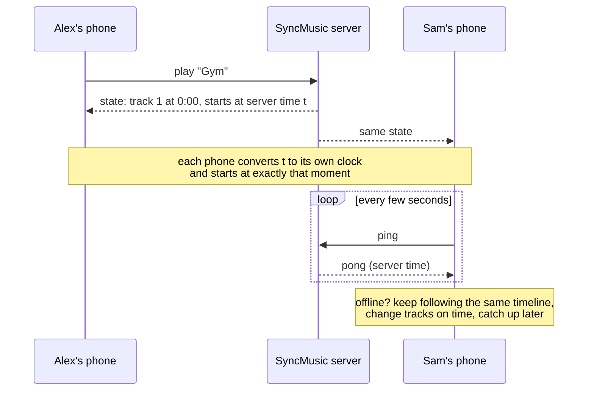

The server keeps every room's state as a **timeline**: *track T is at position P at server time A, playing or paused*. Any phone can evaluate that on its own, so it needs no stream of position updates, and a lost or late message cannot push it out of sync: the newest state simply replaces the old one. Offline phones keep evaluating the same timeline with the same rules as the server (both implementations are tested against shared fixtures), including automatic track changes.

Starts are scheduled slightly in the future, so all phones start together instead of each catching up. Each phone measures its clock offset to the server from the fastest ping round trips, keeps its audio on the timeline by adjusting the playback rate by up to 5% (pitch preserved), seeks only for big jumps and learns its own play latency.

More in [docs/architecture.md](docs/architecture.md) and [docs/protocol.md](docs/protocol.md).

## Configuration

Everything is set with environment variables; the defaults suit the container. The ones you are most likely to touch:

| Variable | Default | Description |
|---|---|---|
| `SYNCMUSIC_PASSWORD` | *(none)* | Shared password. Without it anyone who can reach the server can use it. `SYNCMUSIC_PASSWORD_FILE` reads it from a file (Docker secrets). |
| `SYNCMUSIC_TRUST_PROXY` | `false` | Trust `X-Forwarded-For`/`-Proto`. Enable behind Tailscale Serve or a reverse proxy. |
| `SYNCMUSIC_TRANSCODE_CACHE_SIZE` | `4GiB` | Disk space for transcoded files (least recently used are removed first). |
| `SYNCMUSIC_WAIT_FOR_ALL_MAX` | `10s` | Longest wait for slow phones when "Wait for everyone" is on. |

<details>
<summary><b>All settings</b></summary>

| Variable | Default | Description |
|---|---|---|
| `SYNCMUSIC_MUSIC_DIR` | `/music` | Music library (read-only access is enough). |
| `SYNCMUSIC_DATA_DIR` | `/data` | Database, caches and the session key. |
| `SYNCMUSIC_LISTEN` | `:8080` | HTTP listen address (`PORT` is honoured too). |
| `SYNCMUSIC_PASSWORD` / `_FILE` | *(none)* | Shared password, or a file containing it. |
| `SYNCMUSIC_TRANSCODE` | `true` | Transcode to Opus/AAC for phones. |
| `SYNCMUSIC_TRANSCODE_CACHE_SIZE` | `4GiB` | Maximum size of the transcode cache. |
| `SYNCMUSIC_TRANSCODE_WORKERS` | half the CPUs | Parallel ffmpeg processes. |
| `SYNCMUSIC_SCAN_INTERVAL` | `15m` | Incremental rescans (`0` disables). Rescans can also be started from the app. |
| `SYNCMUSIC_START_DELAY` | `1500ms` | Lead time before a newly selected track starts on all phones. |
| `SYNCMUSIC_RESUME_DELAY` | `400ms` | Lead time for play and seek. |
| `SYNCMUSIC_WAIT_FOR_ALL_MAX` | `10s` | Longest wait for slow phones when "Wait for everyone" is on. |
| `SYNCMUSIC_SESSION_TTL` | `180d` | How long a login stays valid. |
| `SYNCMUSIC_TRUST_PROXY` | `false` | Trust `X-Forwarded-For`/`-Proto`. |
| `SYNCMUSIC_COOKIE_SECURE` | `auto` | `true`, `false` or `auto` (secure when the request arrived over HTTPS). |
| `SYNCMUSIC_ALLOWED_ORIGINS` | *(none)* | Extra WebSocket origins, comma separated host patterns. |
| `SYNCMUSIC_ROOM_IDLE_TIMEOUT` | `12h` | Unload rooms nobody joined for this long (their state is kept). |
| `SYNCMUSIC_METRICS` | `true` | Prometheus metrics at `/metrics`. |
| `SYNCMUSIC_LOG_LEVEL` / `SYNCMUSIC_LOG_FORMAT` | `info` / `text` | `debug`…`error`; `text` or `json`. |
| `SYNCMUSIC_FFMPEG` / `SYNCMUSIC_FFPROBE` | `ffmpeg` / `ffprobe` | Paths to the media tools. |

Health endpoints: `/healthz` (liveness) and `/readyz` (readiness). The image runs `syncmusic healthcheck` as its Docker health check.

</details>

Backups, Raspberry Pi notes, a systemd unit and reverse proxy examples are in [docs/deployment.md](docs/deployment.md).

## Troubleshooting

| Symptom | What to do |
|---|---|
| The screen says *Tap to listen* | The browser blocks sound until the first touch. Tap the screen once. |
| One phone plays later than the others | Almost always Bluetooth delay: raise *Settings → Headphone delay*. The listener list shows each phone's offset. |
| No *Add to Home screen* or no offline mode | The app must be opened over HTTPS (Tailscale Serve or a reverse proxy). |
| *The app is open in another tab* | Close the other tab or tap *Use here*. |
| A track shows a crossed-out cloud | You are offline and that track isn't saved on the phone yet. |

## Development

Requirements: Go 1.26+, Node.js 22+, ffmpeg.

```sh
make web          # build the web client into internal/webui/dist
make run          # run the server against ./music
make dev          # in another terminal: Vite dev server on :5173 (proxies the API)
make test         # Go (race detector) + web unit tests
make e2e          # Playwright end-to-end tests with two emulated phones
make lint         # golangci-lint, ESLint, TypeScript, Prettier
make screenshots  # regenerate the images in docs/images
make docker       # build the container image
```

The code is covered by unit, integration, fuzz and end-to-end tests; CI runs all of them plus a container smoke test on every push. See [CONTRIBUTING.md](CONTRIBUTING.md) for the project layout, conventions and how to cut a release.

## License

[MIT](LICENSE)
