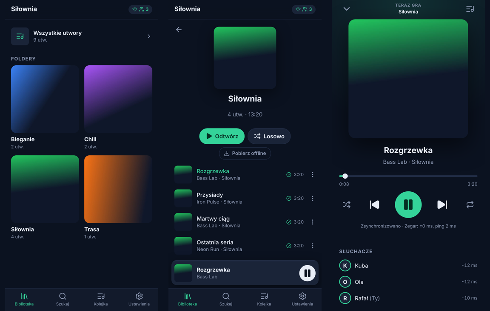

# SyncMusic

**Listen together, perfectly in sync.** SyncMusic is a self-hosted music server for small groups: everyone opens the web app on their phone, joins a room, and hears the same track at the same moment, each through their own headphones. Built for the gym, a run with friends or a road trip, where the network is weak and drops out now and then.

- **One container, one binary.** Go server, SQLite and the web app in a ~47 MB image. Point it at a music folder and you are done.
- **Tight sync.** NTP-style clock sync and playback-rate correction keep the phones aligned. In the end-to-end tests (two emulated Android phones in headless Chromium) they end up about 1 ms apart and within about 6 ms of the room timeline; the tests fail above 80 ms.
- **Made for bad connections.** Upcoming tracks are downloaded ahead, whole folders can be saved for offline use, transcoding to Opus/AAC makes files 5–10× smaller, and the client reconnects on its own.
- **Keeps playing offline.** The room state is a timeline, so every phone keeps following it without a network, including moving to the next track at the right moment, and catches up again when the connection returns.
- **Your folders are your playlists.** Subfolders of the music directory become playlists, loose files are listed separately, and `.m3u` playlists are imported too.
- **Installable PWA** in Polish and English with lock-screen controls (Media Session), personal pause for headphone buttons and phone calls, and a shared queue.

<p align="center"></p>

## Quick start

You need Docker, a folder of music and, for phones, an HTTPS address. [Tailscale](https://tailscale.com) provides that for free and works across networks (see [Deployment](docs/deployment.md)).

```sh
mkdir syncmusic && cd syncmusic
curl -fsSLO https://raw.githubusercontent.com/RafalPolawski/SyncMusic/main/compose.yaml
cat > .env <<'EOF'
MUSIC_DIR=/path/to/your/music
SYNCMUSIC_PASSWORD=pick-a-password
EOF
docker compose up -d
tailscale serve --bg 8080      # https://<machine>.<tailnet>.ts.net
```

Open the address on every phone, enter your name, the room and the password, then use "Add to home screen" to install the app.

Prefer a Tailscale sidecar so the server gets its own name in your tailnet? Use [`compose.tailscale.yaml`](compose.tailscale.yaml). No Docker? Download a binary from the [releases](https://github.com/RafalPolawski/SyncMusic/releases) and install `ffmpeg` (see [Running without Docker](docs/deployment.md#running-without-docker)).

### Music folder layout

```
music/
├── Gym/                 → playlist "Gym"
│   ├── 01 - Warm up.mp3
│   └── Leg day/         → nested folder, part of "Gym"
├── Chill/               → playlist "Chill"
├── running.m3u          → playlist from an .m3u file
└── Some song.flac       → "Loose tracks"
```

Tags (title, artist, album, track number) are read when present. Otherwise names such as `03 - Artist - Title.mp3` are understood. Folder art (`cover.jpg`, `folder.jpg`, …) and embedded art are supported. Supported formats are MP3, FLAC, Ogg Vorbis/Opus, M4A (AAC/ALAC), WAV, AIFF, WMA, APE, WavPack and MKA.

## How it works

The server owns each room's state as a **timeline**: *track T is at position P at server time A, playing or paused*. Any phone can evaluate that on its own clock, so it needs no stream of position updates, and a lost or late message cannot push it out of sync. The newest state simply replaces the old one. While offline, phones keep evaluating the same timeline with the same rules as the server (both implementations are tested against shared fixtures), including automatic track changes.

Starts are scheduled slightly in the future, so all phones start together instead of each catching up. With **Wait for everyone** enabled (the default) the room also waits up to a few seconds until every phone has buffered a newly picked track. Each phone measures its clock offset to the server from the fastest ping round trips. It keeps its audio element on the timeline by adjusting `playbackRate` by up to 5% (pitch preserved) and seeks only for large jumps. It also learns its own play latency, and there is a setting for Bluetooth headphone delay.

More in [docs/architecture.md](docs/architecture.md) and [docs/protocol.md](docs/protocol.md).

## Configuration

Everything is set through environment variables. The defaults suit the container.

| Variable | Default | Description |
|---|---|---|
| `SYNCMUSIC_PASSWORD` | *(none)* | Shared password. Without it anyone who can reach the server can use it. `SYNCMUSIC_PASSWORD_FILE` reads it from a file (Docker secrets). |
| `SYNCMUSIC_MUSIC_DIR` | `/music` | Music library (read-only access is enough). |
| `SYNCMUSIC_DATA_DIR` | `/data` | Database, caches and the session key. |
| `SYNCMUSIC_LISTEN` | `:8080` | HTTP listen address (`PORT` is honoured too). |
| `SYNCMUSIC_TRANSCODE` | `true` | Transcode to Opus/AAC for phones. |
| `SYNCMUSIC_TRANSCODE_CACHE_SIZE` | `4GiB` | Maximum size of the transcode cache (LRU). |
| `SYNCMUSIC_TRANSCODE_WORKERS` | half the CPUs | Parallel ffmpeg processes. |
| `SYNCMUSIC_SCAN_INTERVAL` | `15m` | Incremental rescans (`0` disables). Rescans can also be started from the app. |
| `SYNCMUSIC_START_DELAY` | `1500ms` | Lead time before a newly selected track starts on all phones. |
| `SYNCMUSIC_RESUME_DELAY` | `400ms` | Lead time for play and seek. |
| `SYNCMUSIC_WAIT_FOR_ALL_MAX` | `10s` | Longest wait for slow phones when "Wait for everyone" is on. |
| `SYNCMUSIC_SESSION_TTL` | `180d` | How long a login stays valid. |
| `SYNCMUSIC_TRUST_PROXY` | `false` | Trust `X-Forwarded-For`/`-Proto` (enable behind Tailscale Serve or a reverse proxy). |
| `SYNCMUSIC_COOKIE_SECURE` | `auto` | `true`, `false` or `auto` (secure when the request arrived over HTTPS). |
| `SYNCMUSIC_ALLOWED_ORIGINS` | *(none)* | Extra WebSocket origins, comma separated host patterns. |
| `SYNCMUSIC_ROOM_IDLE_TIMEOUT` | `12h` | Unload rooms nobody joined for this long (their state is kept). |
| `SYNCMUSIC_METRICS` | `true` | Prometheus metrics at `/metrics`. |
| `SYNCMUSIC_LOG_LEVEL` / `SYNCMUSIC_LOG_FORMAT` | `info` / `text` | `debug`…`error`; `text` or `json`. |
| `SYNCMUSIC_FFMPEG` / `SYNCMUSIC_FFPROBE` | `ffmpeg` / `ffprobe` | Paths to the media tools. |

Health endpoints: `/healthz` (liveness) and `/readyz` (readiness). The image runs `syncmusic healthcheck` as its Docker health check.

## Using the app

- **Play / Shuffle** on a folder starts it for the whole room. The **⋯** menu on a track adds it to the shared queue or plays it next.
- **Pause in the app** pauses the room. **Headphone buttons, the lock screen and phone calls** pause only your phone by default (so taking out earbuds between sets does not stop everyone). Change this in *Settings → Headphone and lock screen buttons*. Tap *Back to the room* to rejoin.
- **Download for offline** on a folder or playlist keeps it on the phone. Upcoming tracks are always fetched a few songs ahead (configurable), within a storage limit.
- **Settings → Headphone delay** compensates Bluetooth latency if you hear the music later than your friends.
- Lower **Quality** helps a lot on a weak connection: *Low* is about 0.5 MB per minute.

## Development

Requirements: Go 1.26+, Node.js 22+, ffmpeg (for tests and local runs).

```sh
make web          # build the web client into internal/webui/dist
make run          # run the server against ./music
make dev          # in another terminal: Vite dev server on :5173 (proxies the API)
make test         # Go (race detector) + web unit tests
make e2e          # Playwright end-to-end tests with two simulated phones
make lint         # golangci-lint, ESLint, TypeScript, Prettier
make docker       # build the container image
```

See [CONTRIBUTING.md](CONTRIBUTING.md) for the project layout, conventions and the release process.

## License

[GNU General Public License v3.0](LICENSE)
