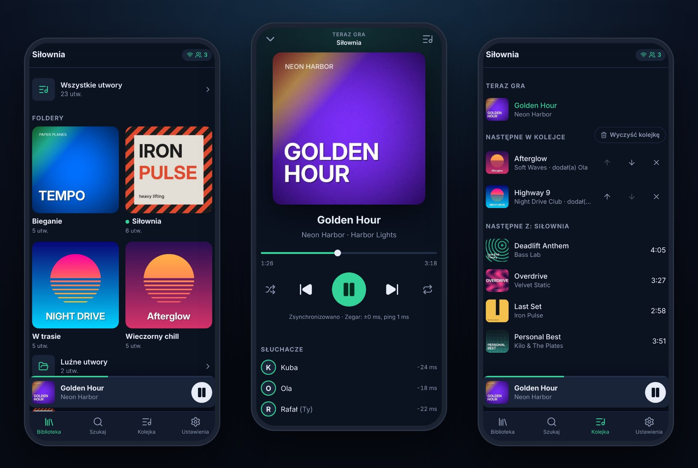
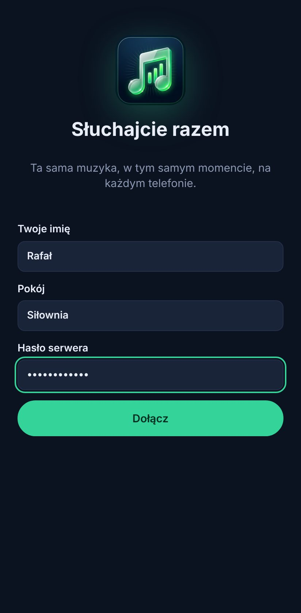
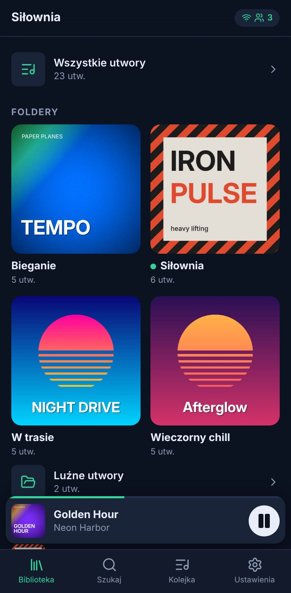
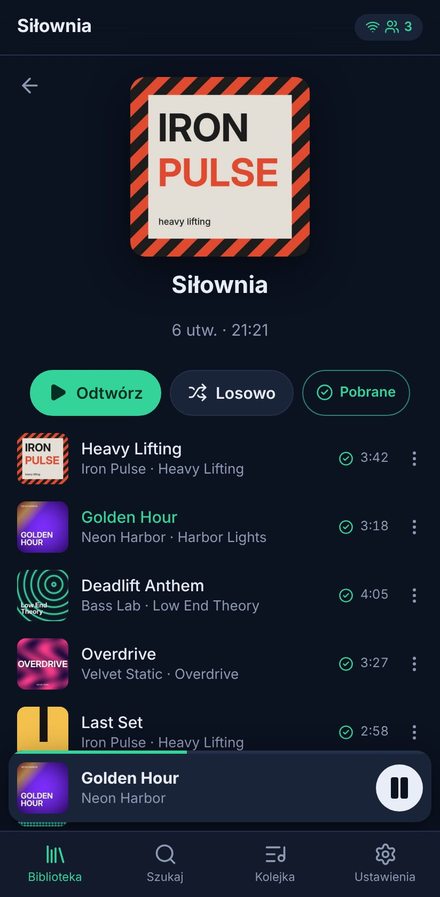
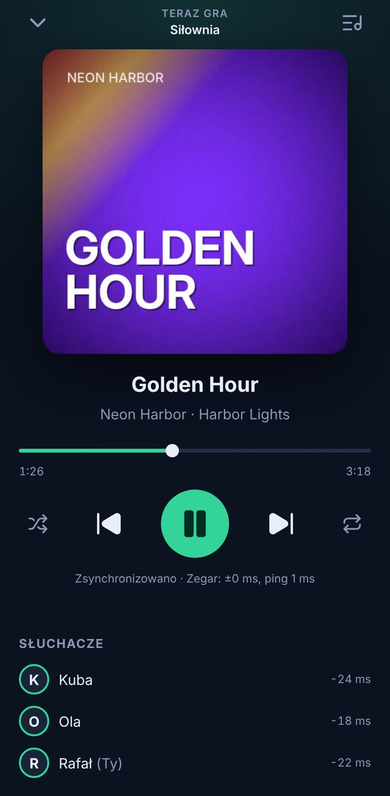
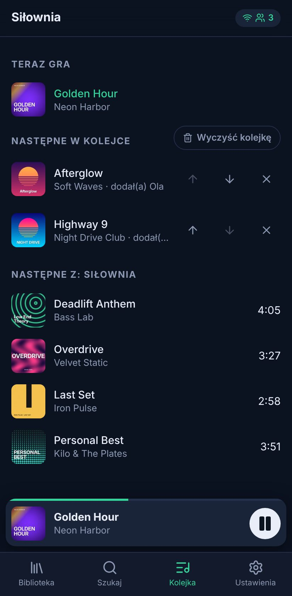
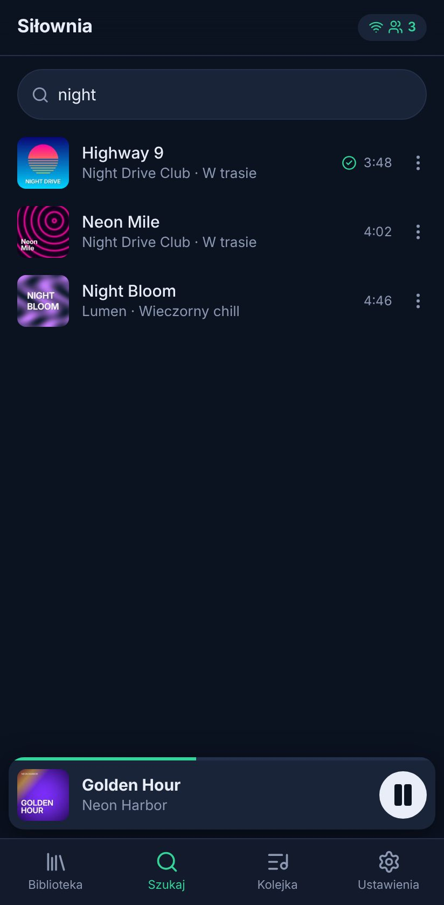
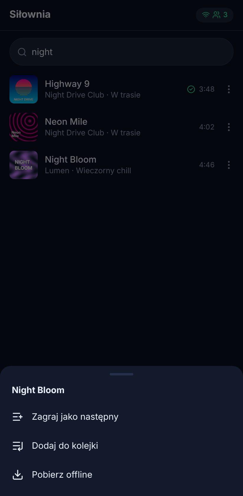
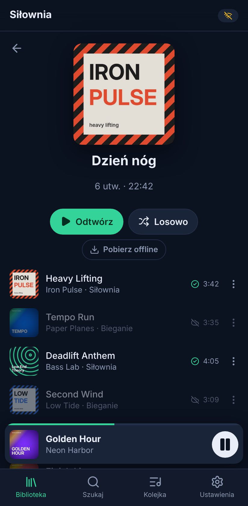
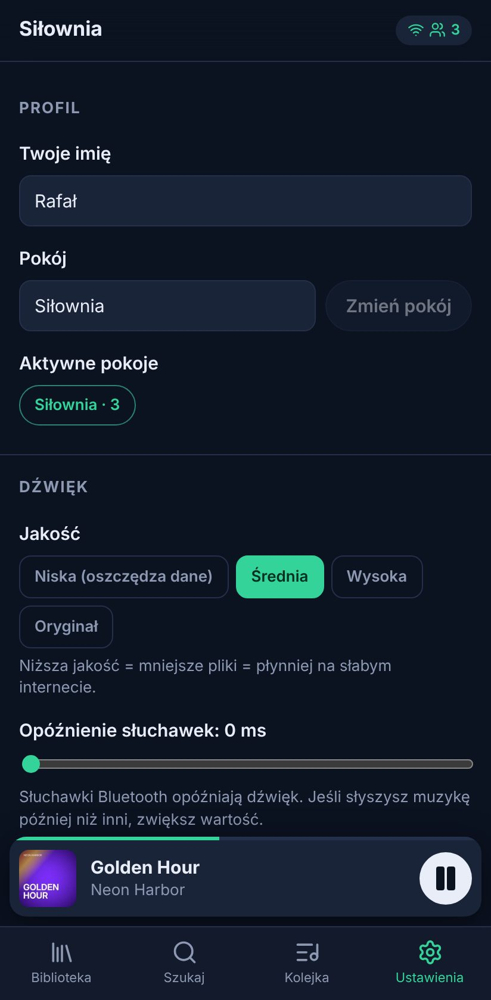

<p align="center">
  
</p>

<h1 align="center">SyncMusic po polsku</h1>

<p align="center">
  <b>Słuchajcie razem, idealnie równo.</b><br>
  Twoja muzyka na telefonach wszystkich znajomych, w tym samym momencie,<br>
  każdy we własnych słuchawkach. Nawet gdy Wi-Fi na siłowni odmawia posłuszeństwa.
</p>

<p align="center">
  
</p>

SyncMusic to własny, mały serwer muzyki do wspólnego słuchania. Stawiasz go w domu (albo na Raspberry Pi), wskazujesz katalog z muzyką, a znajomi otwierają aplikację w przeglądarce telefonu i słyszą ten sam utwór w tym samym momencie. Sprawdza się na siłowni, na wspólnym bieganiu i w trasie, czyli tam, gdzie internet bywa słaby.

## Co potrafi

- 🎧 **Równo co do milisekundy.** Synchronizacja zegarów jak w NTP i delikatna korekta tempa odtwarzania. W testach dwa emulowane telefony z Androidem grają ok. **1 ms** od siebie.
- 📶 **Słaby internet to nie problem.** Kolejne utwory pobierają się z wyprzedzeniem, całe foldery można zapisać w telefonie, a transkodowanie do Opus zmniejsza pliki 5–10 razy.
- ✈️ **Bez internetu gra dalej.** Telefon sam pilnuje osi czasu pokoju, przechodzi do następnego utworu dokładnie wtedy, kiedy u innych, i sam się synchronizuje po powrocie zasięgu.
- 📁 **Foldery to playlisty.** Podfoldery katalogu z muzyką stają się playlistami, pliki `.m3u` też są wczytywane, a luźne pliki trafiają na osobną listę.
- 👥 **Dla ekipy.** Wspólna kolejka („dodał(a) Ola”), losowanie i powtarzanie dla całego pokoju, lista słuchaczy z informacją, ile kto się rozjeżdża, i „czekaj na wszystkich” przy zmianie utworu.
- 🔒 **Pauza tylko dla siebie.** Wyjęcie słuchawki albo telefon od mamy pauzuje tylko twój telefon. *Wróć do pokoju* i grasz znowu równo z innymi.
- 📦 **Jeden mały kontener** (~47 MB, `amd64` i `arm64`) albo jeden plik wykonywalny dla Linuksa, macOS i Windowsa. Bez bazy danych i bez kont, jedno wspólne hasło.

## Jak to postawić

Potrzebujesz Dockera, katalogu z muzyką i adresu HTTPS dla telefonów (bez HTTPS przeglądarka nie pozwoli zainstalować aplikacji ani zapisywać muzyki offline). Najprościej dostać go przez [Tailscale](https://tailscale.com): działa między różnymi sieciami, bez przekierowywania portów, a certyfikat jest prawdziwy.

**1. Serwer**

```sh
mkdir syncmusic && cd syncmusic
curl -fsSLO https://raw.githubusercontent.com/RafalPolawski/SyncMusic/main/compose.yaml
cat > .env <<'EOF'
MUSIC_DIR=/sciezka/do/muzyki
SYNCMUSIC_PASSWORD=wymysl-haslo
SYNCMUSIC_TRUST_PROXY=true
EOF
docker compose up -d
```

**2. Adres HTTPS**

```sh
tailscale serve --bg 8080      # → https://<nazwa-komputera>.<tailnet>.ts.net
```

Znajomych zaproś do swojego tailnetu albo [udostępnij im ten komputer](https://tailscale.com/kb/1084/sharing). Muszą mieć zainstalowaną aplikację Tailscale na telefonie. Zamiast `tailscale serve` możesz użyć gotowego kontenera z Tailscale: [`compose.tailscale.yaml`](../compose.tailscale.yaml) (opis w [deployment.md](deployment.md#option-b-tailscale-sidecar-container)).



**3. Telefony**

Na każdym telefonie otwórz adres, wpisz imię, pokój (np. *Siłownia*) i hasło, a potem w menu Chrome (⋮) wybierz **Dodaj do ekranu głównego**. Od tej pory SyncMusic działa jak zwykła aplikacja.

Wszyscy, którzy wpiszą ten sam pokój, słyszą to samo. Wybierz folder, dotknij **Odtwórz** i gotowe.

Chcesz konkretną wersję zamiast `latest`? Dopisz `SYNCMUSIC_VERSION=1.0.0` do `.env`.

<br clear="right">

## Jak ułożyć muzykę

```
muzyka/
├── Siłownia/            → playlista „Siłownia”
│   ├── 01 - Rozgrzewka.mp3
│   └── Nogi/            → podfolder, też należy do „Siłownia”
├── Wieczorny chill/     → playlista „Wieczorny chill”
├── bieganie.m3u         → playlista z pliku .m3u
└── Jakiś utwór.flac     → „Luźne utwory”
```

Tytuły i wykonawcy są brane z tagów, a jeśli ich nie ma, z nazwy pliku (np. `03 - Wykonawca - Tytuł.mp3`). Okładki są brane z pliku albo z `cover.jpg` / `folder.jpg` w katalogu. Nowe pliki są wykrywane same co 15 minut, a od razu po kliknięciu *Ustawienia → Przeskanuj bibliotekę*.

## Zrzuty ekranu

<table>
  <tr>
    <td align="center"><br><sub><b>Biblioteka</b><br>foldery, playlisty, luźne utwory</sub></td>
    <td align="center"><br><sub><b>Folder</b><br>odtwórz, losowo, pobierz offline</sub></td>
    <td align="center"><br><sub><b>Teraz gra</b><br>synchronizacja i słuchacze</sub></td>
    <td align="center"><br><sub><b>Wspólna kolejka</b><br>każdy może dodawać</sub></td>
  </tr>
  <tr>
    <td align="center"><br><sub><b>Szukanie</b><br>bez polskich znaków też działa</sub></td>
    <td align="center"><br><sub><b>Menu utworu</b><br>następny, kolejka, pobierz</sub></td>
    <td align="center"><br><sub><b>Bez internetu</b><br>pobrane utwory grają dalej</sub></td>
    <td align="center"><br><sub><b>Ustawienia</b><br>jakość, opóźnienie słuchawek</sub></td>
  </tr>
</table>

## Jak tego używać na siłowni

- **Odtwórz / Losowo** na folderze włącza go całemu pokojowi. Menu **⋯** przy utworze pozwala zagrać go jako następny albo dodać do wspólnej kolejki.
- **Pauza w aplikacji** zatrzymuje cały pokój. **Przyciski słuchawek, ekran blokady i połączenia telefoniczne** pauzują tylko twój telefon, więc wyjęcie słuchawek między seriami nie zatrzymuje wszystkich. Można to zmienić w ustawieniach (*Sterują całym pokojem*).
- **Pobierz offline** na folderze zapisuje go w telefonie. Kilka następnych utworów i tak zawsze pobiera się w tle.
- **Słaby zasięg?** Ustaw *Jakość → Niska* (Opus 64 kb/s, ok. 0,5 MB na minutę) i pobierz playlisty przed wyjściem z domu.
- **Słuchawki Bluetooth** mają opóźnienie. Jeśli słyszysz muzykę później niż koledzy, zwiększ *Ustawienia → Opóźnienie słuchawek*. Lista słuchaczy na ekranie odtwarzacza pokazuje, ile kto się rozjeżdża.
- **Czekaj na wszystkich** (domyślnie włączone): po zmianie utworu pokój czeka, aż każdy go wczyta (maksymalnie kilka sekund), i wtedy startuje wszystkim naraz.

## Aktualizacja

```sh
docker compose pull && docker compose up -d
```

Telefony pokażą informację o nowej wersji. Po dotknięciu *Odśwież* aplikacja się zaktualizuje, a grający utwór nie zostanie przerwany.

## Problemy

| Objaw | Co zrobić |
|---|---|
| Na ekranie widać „Dotknij, aby słuchać” | Przeglądarka blokuje dźwięk do pierwszego dotknięcia. Wystarczy dotknąć ekranu. |
| Ktoś gra później niż reszta | Najczęściej to opóźnienie słuchawek Bluetooth, ustaw je w ustawieniach. Różnicę każdej osoby widać w *Teraz gra → Słuchacze*. |
| Brak instalacji jako aplikacja lub brak trybu offline | Strona musi być otwarta przez HTTPS (Tailscale Serve albo reverse proxy). |
| „Aplikacja jest otwarta w innej karcie” | Zamknij drugą kartę albo dotknij *Używaj tutaj*. |
| Przy utworze jest przekreślona chmurka | Jesteś offline, a ten utwór nie jest jeszcze zapisany w telefonie. |

Więcej technicznych szczegółów jest w [README](../README.md), [architecture.md](architecture.md) i [deployment.md](deployment.md) (po angielsku).
